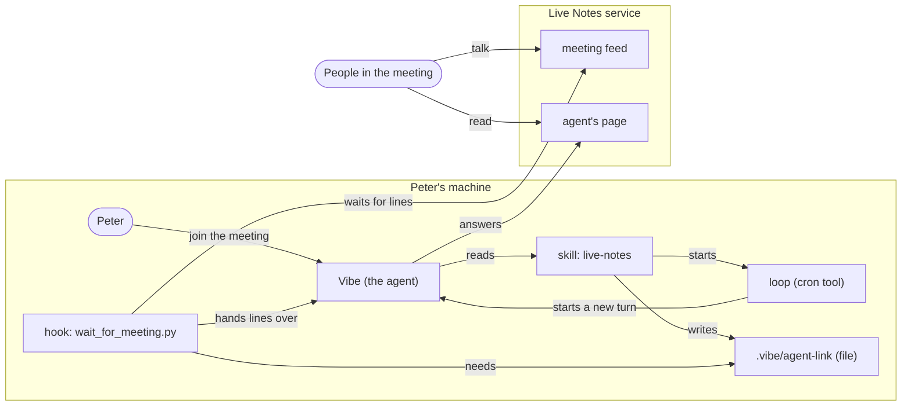
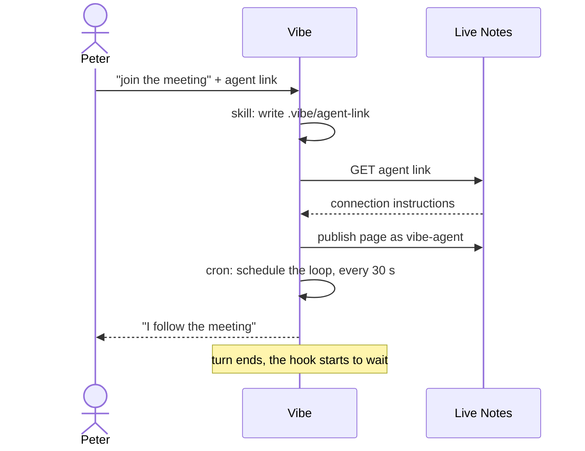
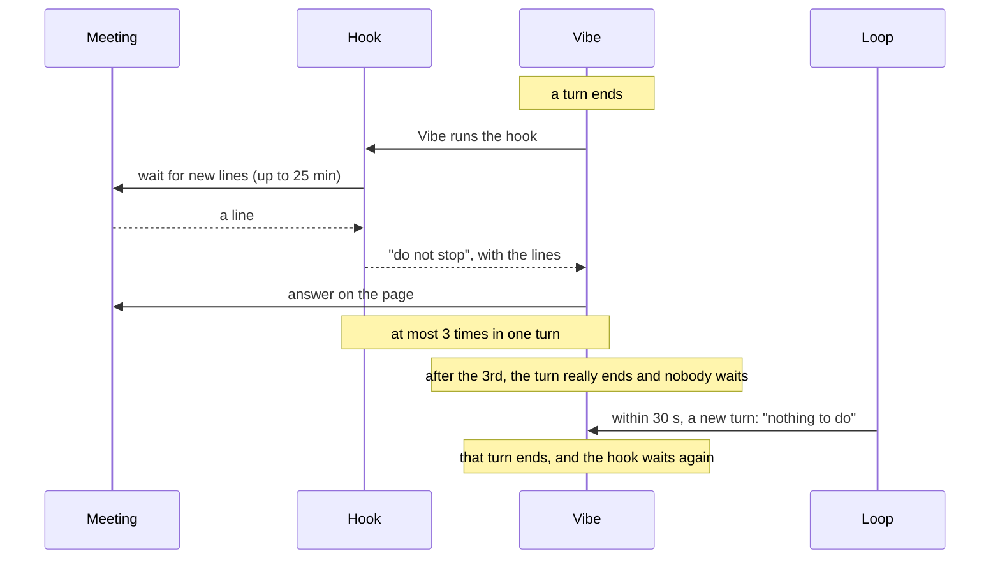
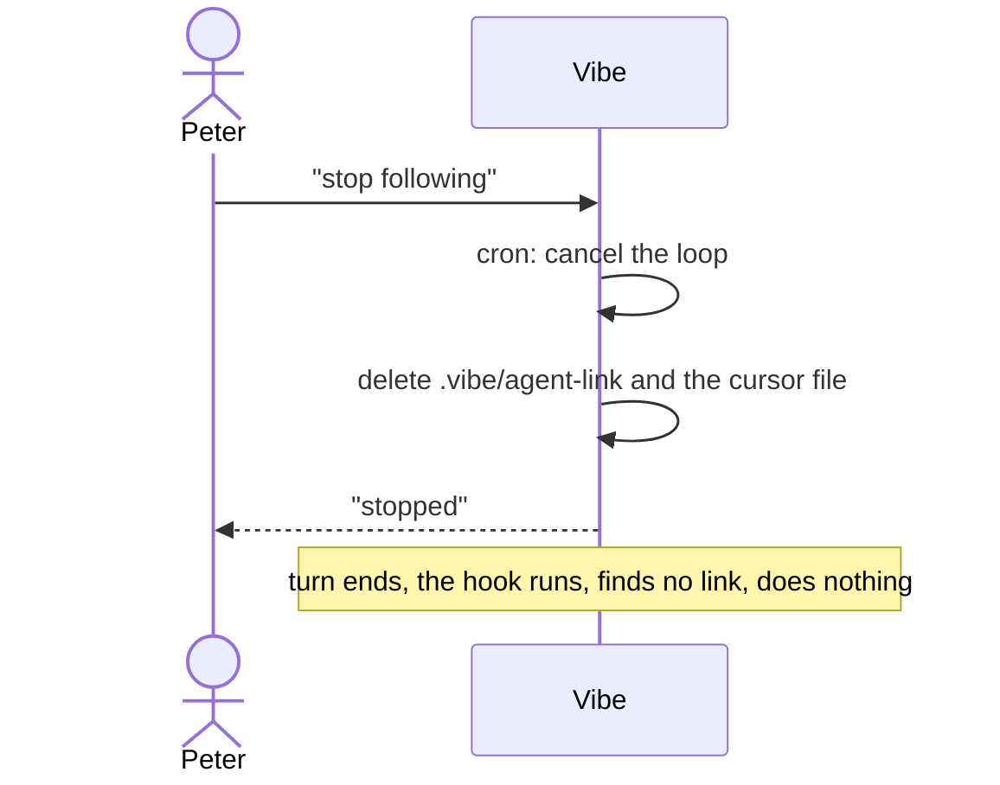

Hand-drawn versions of these four drawings: [drawings/index.html](drawings/index.html).

# How Vibe joins, follows and leaves a meeting

Four drawings, high level. The same parts appear in each.

## 1. The parts

## 2. Join

## 3. Follow

The loop fires only while Vibe is idle. While the hook waits, the turn is not
over, so the loop stays quiet.

## 4. Leave

## What is tested

Only the hook has run in Vibe. The skill, the loop next to the hook, and
leaving are written but not tried.
